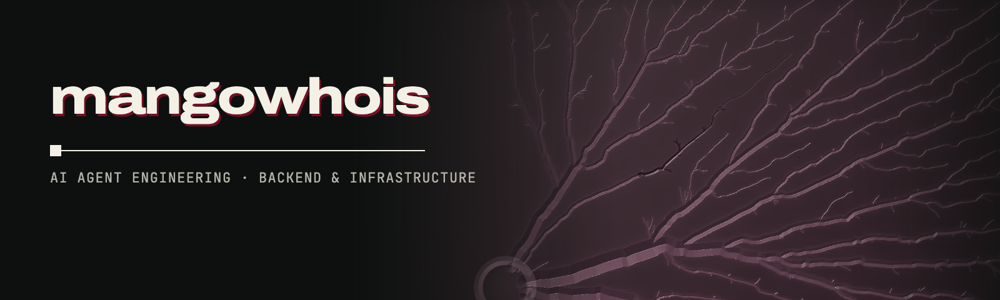

<strong>한국어</strong> · <a href="README_EN.md">English</a>

# 류지환 · Jihwan Ryu

판단에서 실행까지, 추적하고 검증할&nbsp;수&nbsp;있는 에이전트를 만듭니다.

### [mangowhois.ai](https://mangowhois.ai/)

[jihwan.ryu@mangowhois.ai](mailto:jihwan.ryu@mangowhois.ai)&nbsp;· [LinkedIn](https://www.linkedin.com/in/mangowhois/)&nbsp;· [YouTube](https://www.youtube.com/@mango_fr)&nbsp;· [Threads](https://www.threads.com/@mangowhois)&nbsp;· [블로그](https://rooftopsnow.tistory.com)

## 작업

| 프로젝트 | 설명 |
| --- | --- |
| **GEODE** | 연구, 파일 작업, 예약 작업을 맡길 수 있는 로컬 자율 에이전트 하네스 Python&nbsp;· MCP&nbsp;· SQLite&nbsp;· Harbor 개인 프로젝트&nbsp;· [사례](https://mangowhois.ai/geode/)&nbsp;· [코드](https://github.com/mangowhoiscloud/geode) |
| **Eco²** | 사진 한 장과 대화로 분리배출을 안내한 AI 어시스턴트의 백엔드와 클라우드 인프라 Python&nbsp;· Kubernetes&nbsp;· Redis Streams&nbsp;· LangGraph 팀 프로젝트&nbsp;· 2025 AI 새싹톤 우수상&nbsp;· [사례](https://mangowhois.ai/eco2/)&nbsp;· [코드](https://github.com/eco2-team/backend) |
| **Railshot** | 로컬에서 만든 웹 앱을 준비된 클라우드와 온프레미스에 배포하고 운영하는 플랫폼 Python&nbsp;· MCP&nbsp;· IaC&nbsp;· AWS/GCP/OpenStack 팀 프로젝트&nbsp;· [사례](https://mangowhois.ai/railshot/)&nbsp;· [코드](https://github.com/Jasmin-Softbank/Railshot) |
| **REODE** @pinxlab | Java · Spring 코드 마이그레이션 에이전트 Java/Spring&nbsp;· OpenRewrite&nbsp;· Maven&nbsp;· Docker [사례](https://mangowhois.ai/reode/) |
| **Kiki** @pinxlab | 팀의 AI 에이전트 운영을 돕는 Paperclip 플러그인과 Slack 수집 도구 Paperclip&nbsp;· Slack&nbsp;· MCP [사례](https://mangowhois.ai/kiki/) |
| **Cotton** @pinxlab | 게임 대사 번역 워크플로 Hono&nbsp;· BullMQ&nbsp;· Drizzle ORM [사례](https://mangowhois.ai/cotton/) |
| **CRUMB** | 캐주얼 게임 프로토타이핑을 위한 멀티 에이전트 스튜디오 하네스 TypeScript&nbsp;· Claude Code&nbsp;· Codex&nbsp;· Gemini CLI 데모&nbsp;· [사례](https://mangowhois.ai/crumb/)&nbsp;· [코드](https://github.com/mangowhoiscloud/crumb) |

설계 도식, 실험 기록, 평가 데이터는 각 사례 페이지에 있습니다.

## 이력

| 소속 | 역할 |
| --- | --- |
| **@LILT** 2026.10.16 – 현재 | AI Benchmark Engineer · 프리랜스 AI 코딩 에이전트가 터미널에서 푸는 평가 과제를 한국어 원어 데이터로 제작 |
| **@pinxlab** 2026.03.16 – 2026.05.26 | AI Research Engineer AI R&D 프리랜스&nbsp;· REODE&nbsp;· Kiki&nbsp;· Cotton |
| **@Rakuten Symphony Korea** 2024.12.09 – 2025.08.31 | Cloud Engineer (L5) Cloud BU 정규직&nbsp;· C 사용자 인증과 SQLite 자격증명 조회 캐시&nbsp;· MinIO root 초기화 설계·구현&nbsp;· 게이트웨이와 스토리지 서버의 락 경합 조사 |

## 보고서

| 보고서 | PDF |
| --- | --- |
| **GEODE 기술 보고서** 92쪽 | [한국어](https://tech.mangowhois.ai/geode/report/ko.pdf)&nbsp;· [English](https://tech.mangowhois.ai/geode/report/en.pdf) |
| **Decision Offloading w. Jev** 81쪽 | [한국어](https://tech.mangowhois.ai/jev/system-1-offloading/ko.pdf)&nbsp;· [English](https://tech.mangowhois.ai/jev/system-1-offloading/en.pdf) |
| **JEVDB 논문 리뷰** 19쪽 | [English](https://tech.mangowhois.ai/jev/db-review/en.pdf) |
| **Eco² 기술 보고서** 32쪽 | [한국어](https://tech.mangowhois.ai/eco2/report/ko.pdf)&nbsp;· [English](https://tech.mangowhois.ai/eco2/report/en.pdf) |
